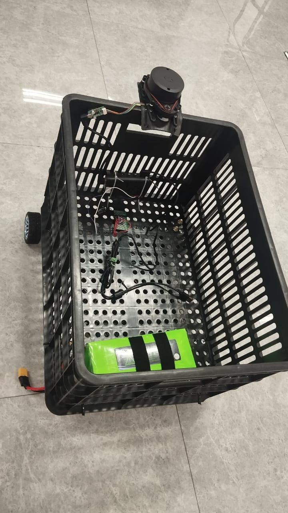
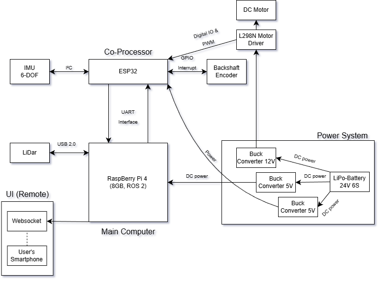
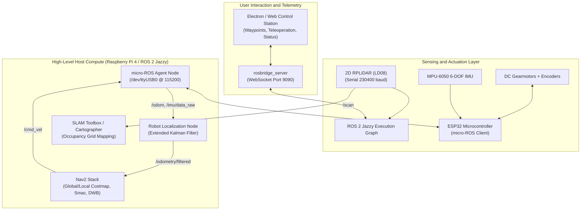
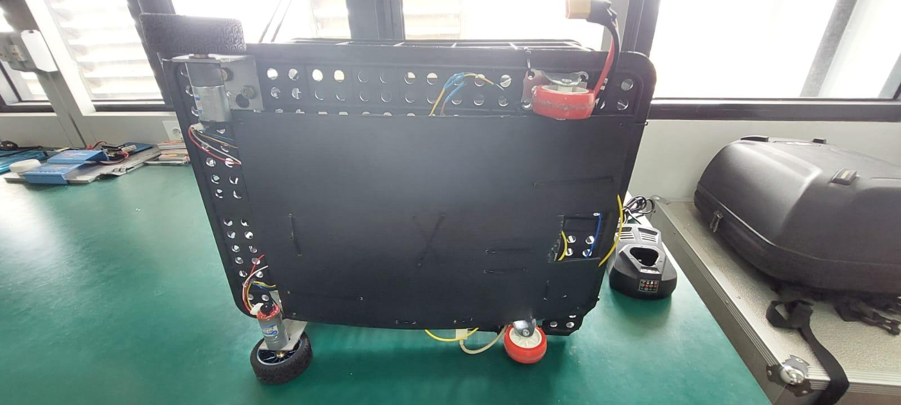
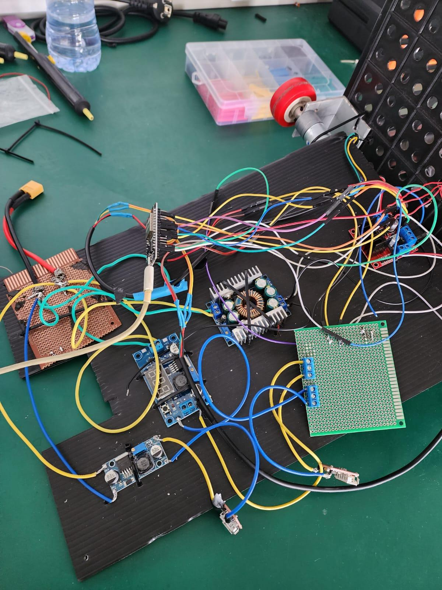
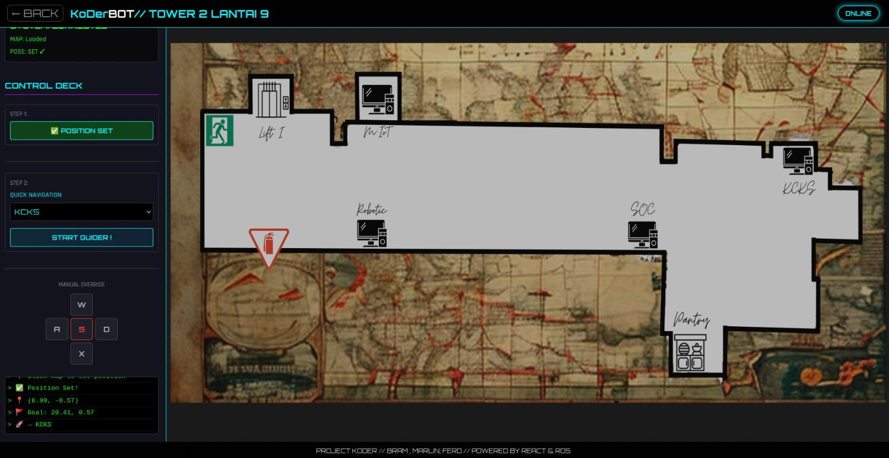

# KoDer: Autonomous Mobile Robot with ROS 2 Jazzy & micro-ROS

[](https://docs.ros.org/en/jazzy/)
[](https://micro.ros.org/)
[](https://navigation.ros.org/)
[]()
[]()

> **KoDer (Keranjang Otonom Dengan Estimasi Rute)** is an autonomous differential-drive mobile robot built on a distributed compute architecture. It demonstrates deterministic low-level actuator control on a bare-metal microcontroller linked natively via **micro-ROS** to a high-level compute SBC running **ROS 2 Jazzy Jalisco**, **SLAM**, and the **Nav2** autonomous navigation stack.

[](https://youtu.be/Vn7qHD_Dkvs)  
*Video Demo: [Watch KoDer Autonomous SLAM, micro-ROS Bringup & Nav2 Obstacle Avoidance (YouTube)](https://youtu.be/Vn7qHD_Dkvs)*

---

  
*Figure 1: KoDer autonomous mobile platform featuring forward-mounted 2D RPLiDAR, internal 3S LiPo battery containment, and differential drive base.*

---

## 1. System Architecture: Distributed Compute Pipeline

Traditional low-cost robotics systems often rely on brittle, non-standard serial string parsers between microcontrollers and host computers. KoDer addresses this by adopting a **Hardware Abstraction Layer (HAL)** powered by **micro-ROS on an ESP32**, allowing the microcontroller to live as a first-class citizen inside the ROS 2 DDS computational graph.

  
*Figure 2: Distributed hardware topology linking Raspberry Pi 4 host compute with the ESP32 real-time motor controller.*



---

## 2. Hardware Stack & Power Distribution

  
*Figure 3: Underside chassis assembly showing dual high-torque DC gearmotors, passive casters, and isolated power distribution routing.*

| Subsystem | Hardware Component | Role & Specifications |
| :--- | :--- | :--- |
| **High-Level Compute** | Raspberry Pi 4 Model B (4GB) | Runs Ubuntu 24.04 LTS, ROS 2 Jazzy, Nav2 planners, SLAM mapping. |
| **Low-Level Real-Time** | ESP32-WROOM-32 | Runs micro-ROS client, dual-wheel closed-loop PID control, IMU filtering. |
| **Perception Sensor** | 2D LiDAR (LD08) | 360° laser triangulation, 8m detection radius, 10Hz scan rate. |
| **Inertial & Odom** | MPU-6050 + Optical Encoders | 6-DOF angular rate & acceleration combined with wheel tick interrupts. |
| **Power Management** | 3S LiPo (11.1V - 12.6V) | Split rail: 12V high-power motor drivers, dual isolated 5.1V buck converters for RPi & ESP32. |

  
*Figure 4: Prototype power regulation circuit with dual buck converters, motor drivers, and ESP32 pinout breakouts.*

---

## 3. Autonomous Navigation & Web Teleoperation

KoDer includes an integrated Web GUI built with React communicating over WebSockets via `rosbridge_server`. Operators can visualize metric maps, set dynamic goal coordinates, and monitor odometry telemetries in real-time.

  
*Figure 5: Real-time mapping and autonomous path navigation dashboard running inside ITS Tower 2 (Floor 9).*

### Key Technical Implementations:
1. **micro-ROS Direct DDS Integration:**
   * ESP32 runs FreeRTOS tasks publishing `/odom` and `/imu/data_raw` directly to ROS 2 topics over XRCE-DDS serial transport.
   * Subscribes directly to `/cmd_vel` geometries, calculating left/right differential velocities with hardware PWM timers.
2. **Sensor Fusion via Extended Kalman Filter (EKF):**
   * Uses `robot_localization` node fusing high-frequency wheel odometry with low-drift IMU yaw rates to counteract wheel slippage during abrupt turns.
3. **Autonomous Navigation (Nav2):**
   * Employs **Smac 2D Global Planner** for kinematic path generation and **DWB Local Controller** for dynamic obstacle avoidance.
   * Fine-tuned inflation layers and voxel grids to navigate narrow indoor corridors.

---

## 4. Software Modules & Repository Breakdown

```
KoDer/
├── koder_gui_dist3/          # Web/Electron-based fleet operator & mapping UI
├── docs/images/              # Hardware architecture diagrams and system photos
└── KoDer_ws/                 # Core ROS 2 Workspace
    └── src/
        ├── koder_bringup/    # Launch files, Nav2 parameters, costmap YAML configs
        ├── koder_description/# URDF model, transmission definitions, joint state publishers
        ├── ld08_driver/      # Low-level UART driver for 2D RPLiDAR
        └── micro_ros_setup/  # micro-ROS firmware builder and host agent bridge
```

---

## 5. Quickstart: Building & Launching

```bash
# 1. Clone & Initialize Workspace
cd KoDer_ws
colcon build --symlink-install
source install/setup.bash

# 2. Launch micro-ROS Agent (Connects to ESP32 over USB-Serial)
ros2 run micro_ros_agent micro_ros_agent serial --dev /dev/ttyUSB0 -b 115200

# 3. Launch Robot Bringup (Sensors, EKF, URDF transforms)
ros2 launch koder_bringup bringup.launch.py

# 4. Launch SLAM or Nav2 Autonomous Navigation
ros2 launch koder_bringup navigation.launch.py
```

---

## 6. Engineering Performance Benchmarks

* **Control Loop Determinism:** ESP32 PID motor update rate maintained at steady **100 Hz** with jitter $< 1.2\text{ ms}$.
* **SLAM Resolution:** Generated $0.05\text{ m/pixel}$ metric occupancy grid maps over a $250\text{ m}^2$ indoor testing environment.
* **Localization Stability:** Multi-sensor fusion reduced cumulative positional drift to $< 2.8\%$ of total trajectory distance traveled.

---

### Authors & Academic Affiliation
* **Developers:** Abraham Napitupulu, Ferdie Ewaldo Djohan, Andrew Marlin
* **Department:** Department of Computer Engineering, Institut Teknologi Sepuluh Nopember (ITS), Surabaya
* **Advisors:** Dr. Ahmad Zaini, S.T., M.T. | Prof. Dr. I Ketut Eddy Purnama, S.T., M.T. | Dr. Arief Kurniawan, S.T., M.T.
